# Shoutout Desk OBS

**0.6.1:** all badge designs wait for a compatible source heartbeat. A brief disconnect retains fresh queued badges for up to two minutes; outdated pages reload automatically. An unloaded or crashed OBS browser still requires reactivation. Saved profiles and source URLs are unchanged.

**0.6.0: Custom HTML/CSS badges.** The seventh design provides variables, live preview, HTML/CSS editors and a copyable AI brief. Use common or per-streamer templates without changing the six presets or existing data. Fully restart OBS after updating. [Template contract](docs/custom-badges.md).

**0.5.0: Raid priority, repeat raid shoutouts within Twitch limits and six customizable badge designs.**

[English](README.md) | [Українська](README.uk.md) | [Русский](README.ru.md)

Automatic Twitch shoutouts inside a dockable OBS Studio panel. A person from your list is shouted out when they write in chat after their cooldown expires.

**[Download and install](https://github.com/foolka/shoutout-desk-obs/releases/latest)**: Windows EXE + ZIP.

**Already using an older version? [Read this before updating: keep or import your local database](#legacy-import).**

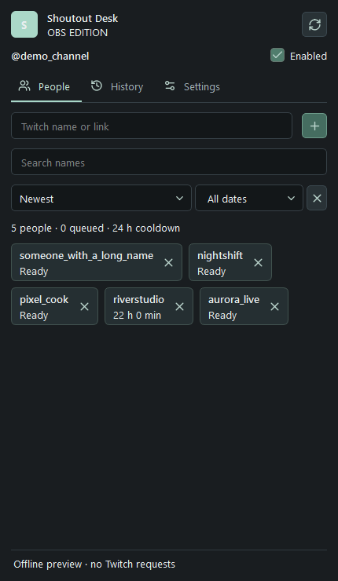

Screenshots use fictional accounts. No personal profiles are included.

## Contents

- [Queue and worker recovery](#recovery)
- [Import a database from the first versions](#legacy-import)
- [Download and install](#install)
- [Setup](#setup)
- [Settings and controls](#settings)
- [Updates and portable mode](#updates)
- [Send diagnostic logs](#diagnostics)
- [Data and privacy](#privacy)
- [Screenshots](#screenshots)
- [Build from source](#build)

<a id="recovery"></a>
## Queue and worker recovery

The dock shows the next person and the earliest sending time. Chat messages wait at least 10 seconds, raids at least 20 seconds, and channel shoutouts are spaced at least 125 seconds apart. Personal cooldowns and Twitch limits can increase the wait. History shows why an entry was skipped or failed.

A temporary disconnect preserves pending people in the same broadcast. A new broadcast, account change, pause or manual reconnect clears pending work; old chat is not replayed. Temporary failures before sending are retried. If a request may already have reached Twitch, it stays unconfirmed rather than risking a duplicate.

If the local worker stops or becomes unresponsive, the dock tries to restart it up to three times, retaining the session's pause state. If it still fails, close OBS and reinstall the complete latest EXE, or reinstall the complete ZIP for portable OBS. Do not delete the data folder or disable antivirus protection. The header's Reconnect button retries after repair. **Settings > Data folder** contains `worker-process.log` and, when available, `worker-diagnostic.log`; these logs have no tokens or passwords. Share only these logs when requesting help, not the database or authorization files.

<a id="install"></a>
## Download and install

Windows 10/11 x64, OBS Studio 32+ with Qt 6.8+. Download **setup.exe** from Releases, close OBS, then run the installer and confirm the administrator prompt. Select your OBS folder if it is not detected. Open OBS from your usual shortcut, then **Docks > Shoutout Desk**. The installer never closes OBS or starts a stream.

<a id="legacy-import"></a>
## Import a database from the first versions

A normal update on the same Windows profile preserves your data automatically: close the program and install over the old version. Import is only needed when switching profiles/computers or moving between the desktop app and OBS plugin.

1. In the old program, open **Settings > Data folder**. Export JSON if that button is available; otherwise find **`shoutouts.sqlite`**. The desktop app normally uses `%APPDATA%\Shoutout Desk`; portable mode uses `ShoutoutDesk-data` next to its EXE.
2. Close the old app/OBS normally, then back up the **whole data folder**. Copying an open SQLite database without its WAL can lose recent records.
3. Open the new version and connect the **same Twitch broadcaster account**.
4. Choose **Settings > Import** and select the JSON export or **`shoutouts.sqlite`**, including databases from the earliest releases. Do not select `connection.json`, an authorization file, or the EXE.
5. People, history and cooldowns are **merged**, not replaced; importing again does not duplicate the same history. Pending actions are not replayed. Automation pauses after import: check the result and enable it when ready.

Authorization is not imported. Keep the backup until you verify the result. The new database uses schema 3; to downgrade, restore a backup made before the upgrade instead of opening the migrated database with an old version.

<a id="badges"></a>
## Shoutout Badges

Open **Badges** from the dock or a person's row. Copy the source URL from the editor and add an OBS **Browser Source** sized **560 × 560**. The transparent source uses local port `18772` while the OBS plugin runs. Its complete URL stays the same across restarts in the same profile; do not use the editor address as the source.

- **Air / Pass / Sticker / Terminal / Ticket / Portrait:** Six designs, each with independent editable colors. Existing themes and descriptions are preserved. Customize width, background and shadow opacity, shadow blur and offset, border style, avatar shape and outline, font weights, captions, visible labels and stamp X/Y offsets. Long names shrink to one line; descriptions wrap.
- Global/per-person display switches, descriptions up to 140 characters, common or personal themes. Customize gradients, borders, corners, padding, fonts, colors and sizes.
- Ten entrance and ten exit effects, selected independently, plus display duration. Enable and customize the floating stamp's text, color, corner, angle and sizes without shifting the content.
- **Test in OBS** and the person's test button display only a badge, without sending a Twitch shoutout or changing history/cooldowns, even if automatic display is disabled. Automatic display requires a fresh confirmed shoutout for a person in your list; duplicate confirmations are coalesced.

Click **Save** after editing. The badge editor currently uses Russian labels. Streamer.bot users should rerun bridge setup for avatar support. Close OBS before installing the update over the existing version and keep the same profile. Badge descriptions, themes and the source URL live in the profile, not the ordinary people-list JSON export; retain the complete data folder for a full transfer. Do not publish the editor URL. Use only one active app/plugin per channel.

<a id="setup"></a>
## Setup

1. In Settings choose **Twitch directly** or **Streamer.bot**.
2. Direct: press **Sign in with Twitch**, confirm the code on the official Twitch page, and allow access to your own broadcaster account. A Public Client ID is already included; no registration is needed.
3. Streamer.bot: first sign in to Twitch as the broadcaster in Streamer.bot 1.0.7. Press **Set up Streamer.bot**; the running copy is detected, or select its EXE. If asked, exit the bot from its tray menu and press the setup button again. The bot is restarted after setup. OBS does not need to close.
4. Add Twitch nicknames or profile links. When your channel is live, a fresh message from a listed person can queue a shoutout.

Run **one active instance per channel**: either this app or the OBS plugin. Separate computers do not share cooldown databases. A shoutout observed from another bot updates the local cooldown and cancels a queued duplicate. Events must reach this instance; this cannot reconstruct shoutouts from before it was connected.

<a id="settings"></a>
## Settings and controls

| Control | Action |
| --- | --- |
| Shout out incoming raiders | Off by default. Queue incoming raiders for at least 20 seconds; observe other bots and respect cooldowns. See below. |
| Notify about new versions | On by default. Background GitHub checks and a release banner; no automatic installation. |
| Enabled | Pause/resume automation for this run. It is enabled again on every launch; this does not reset personal cooldowns. |
| Cooldown, 1–168 hours | Minimum interval per person in this channel. Default: 24 h. Expiry alone sends nothing: a new chat message is required. |
| Reset after long shutdown | Off by default. If closed for strictly more than 60 minutes, reset personal cooldowns on next launch. History remains. Crash recovery includes a 30-second heartbeat allowance. |
| Reset all cooldowns | Requires confirmation. Resets this channel only, keeps people/history and clears queued work. Twitch limits and the local global gap still apply. |
| Connection method | Switch between local Streamer.bot and direct Twitch. Your channel data stays. Another account has its own list and history. |
| Sign in / sign out | Connect your broadcaster account. Sign out removes saved Twitch authorization, not the list/history. |
| Set up Streamer.bot | Backs up actions/settings in the bot's backup directory; installs an authenticated local bridge and enables WebSocket autostart. Preserves its port/password and other actions. Unknown schemas/public bindings are refused. OBS and desktop bridges use different action IDs. |
| Reconnect | Re-establish the selected connection. Does not replay old chat or reset cooldowns. |
| Add / X | Add a nickname or Twitch profile URL; X removes it from the active list, preserving history/cooldown. Duplicates are merged. |
| Search / sort / date | Filter visible people by nickname/date added; sort newest, oldest or name. Does not change who is enabled. |
| History / Add | Shows outcomes and errors. "Confirmed by Twitch" is a stored Twitch event, including events from other tools; it does not necessarily mean this plugin sent it. Previously stored events are also visible. Add restores a person missing from the list without issuing a shoutout. |
| Import | Merge a JSON export or an old shoutouts.sqlite from the same channel. Sign in/connect first. Back up before merging; pause automation. Pending requests are not replayed. Close the source program before copying SQLite. |
| Export | Write a new JSON file with this channel's people, history, cooldown data. No tokens, passwords or bot connection secrets. |
| Data folder | Open the active profile, including automatic backups. Do not publish its contents. |
| Language | English, Ukrainian or Russian. Some diagnostic messages may remain Russian. |
| Check for updates | Manual GitHub release check. A newer stable release can be opened in your browser. No silent downloads or installation. Twitch credentials are not sent to GitHub. |
| Dock / undock | Header button switches floating/docked mode. Drag the panel to an OBS dock area. OBS controls panel visibility and layout. |

**Outcomes:** Sent = confirmed by Twitch; Queued/Sending = pending; Skipped = cancelled or no longer eligible; Error = definite rejection; Unconfirmed = outcome unknown, so automatic resend is blocked for the personal cooldown. There is a 10-second settling window for other bots' events and a 125-second local gap between channel shoutouts. No stream is started by this software.

<a id="updates"></a>
### Incoming raids

**Shout out incoming raiders** is off by default. When enabled, a raider takes priority over queued chat shoutouts, even outside your saved list, without being added to it. The 20-second settling delay still allows another bot to satisfy the raid. Our personal timeout does not block a new raid; Twitch still allows one shoutout every 2 minutes and the same channel once per 60 minutes, with a 5-second safety margin. A waiting raid reserves the queue until it is eligible (up to two hours), so chat entries cannot overtake it. A shoutout already sent before the raid notification arrived cannot be undone. A confirmed shoutout made after this raid cancels its duplicate; older confirmations only delay it.

An actual Twitch shoutout observed from another bot during the wait cancels the duplicate. A plain chat message or a text-only `!so` command is not a Twitch shoutout event. This protection requires a working connection; independent bots cannot be coordinated with an absolute guarantee.

### Update notifications

**Notify about new versions** is on by default. The first background check starts about 15 seconds after launch; successful checks are at most once per day. Offline failures remain quiet and can retry later. A new stable release displays a banner; the desktop app can also show a Windows notification. Nothing is downloaded or installed automatically. Manual **Check for updates** works even with background checks disabled.

**Older releases cannot receive this new automatic notification feature remotely. Update once manually**, then future versions can be announced. Checks contact the public GitHub Releases API and never send Twitch credentials.

## Updates and portable mode

Use **Check for updates**, close OBS and run the new installer. The normal profile remains `%LOCALAPPDATA%\Shoutout Desk OBS`. Uninstalling the plugin leaves this profile intact.

**ZIP / manual install:** extract everything and run `Install.cmd` as administrator for normal OBS. It validates package hashes and keeps a backup of the previous plugin files.

**Portable OBS:** use the same ZIP and `Install-Portable.cmd`, selecting portable OBS's `bin\64bit\obs64.exe`. Enable OBS portable mode first with an empty `portable_mode.txt` in its root. The plugin lives in `obs-plugins\64bit` and `data\obs-plugins`; its separate profile is `config\shoutout-desk-obs` inside portable OBS. Repeat the same installer to update while OBS is closed. Keep `config`; use Export/Import to migrate lists. Windows-protected login requires reauthorization on a different PC. Avoid installing both common and manual copies into the same OBS installation.

<a id="diagnostics"></a>
## Send diagnostic logs

Open **Settings > Diagnostics**, choose **Last hour, 24 hours or 7 days**, then click **Send logs** and confirm. Send the report reference to the maintainer so they can find it.

The report goes to `https://fermionaplay.win` and is visible only to the site owner, for **30 days**. It contains your configured Twitch channel name, app version, connection state, counts and queue outcomes. Event usernames are replaced with per-report identifiers. No chat text, OAuth tokens, passwords, raw exceptions or people database are uploaded. No automatic log uploads occur. Standard server access logs may contain your IP address.

Detailed local logs start with this update, are size-limited and rotate over about 7 days; earlier events are included only when present in saved history. Reports are capped at 1,800 events / 512 KiB and indicate incomplete data. Failed sending leaves your data unchanged; retry later. In OBS, diagnostics use a separate helper and can still work when the main worker is unavailable, provided the bundled runtime is intact.

<a id="privacy"></a>
## Data and privacy

### Sign-in Recovery

Network outages, rate limits and temporary Twitch errors retry automatically without signing you out. A saved account name is not proof of a working connection. If Twitch actually rejects authorization, a non-blocking OBS warning appears even with the dock hidden: **Open settings** reveals the sign-in button; **Later** dismisses it for this session. No browser opens automatically. Your people, history and cooldowns stay intact. Temporary outages and Streamer.bot mode do not trigger this warning.

Everything runs locally. No account on our server is created. Twitch sign-in uses the official Device Code flow with `user:read:chat` and `moderator:manage:shoutouts`; the latter is the API permission name, not a moderator mode. OAuth tokens and bridge credentials are encrypted with Windows protection. JSON exports contain public nicknames and activity timestamps; share them only intentionally. Twitch receives chat subscriptions/shoutout requests; GitHub is contacted when you check updates. Backups remain local.

EXE/ZIP binaries are attached to **GitHub Releases**, not committed into source history. These builds are not code-signed; Windows may show a reputation warning. Check the repository and SHA256 rather than disabling system protection.

<a id="screenshots"></a>
## Screenshots

Six badge designs with separate editable palettes. These are real screenshots with a fictional account. The local badge editor is currently in Russian; badge text can use your own language.

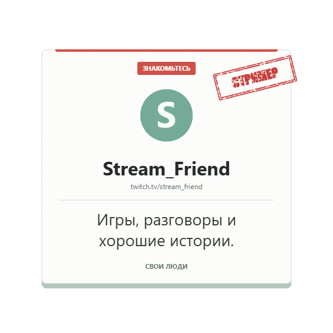

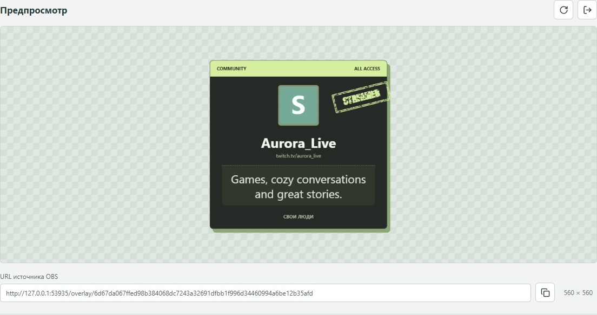

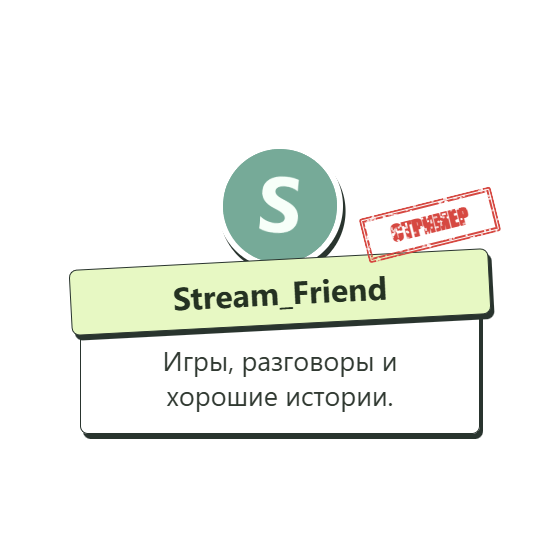

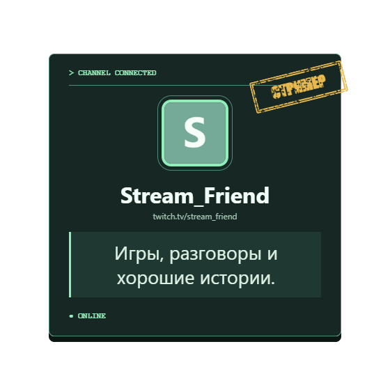

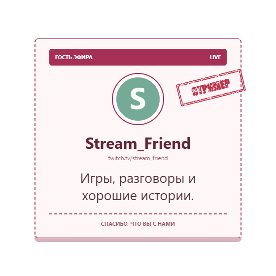

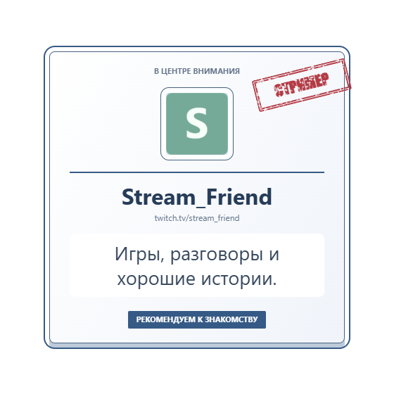

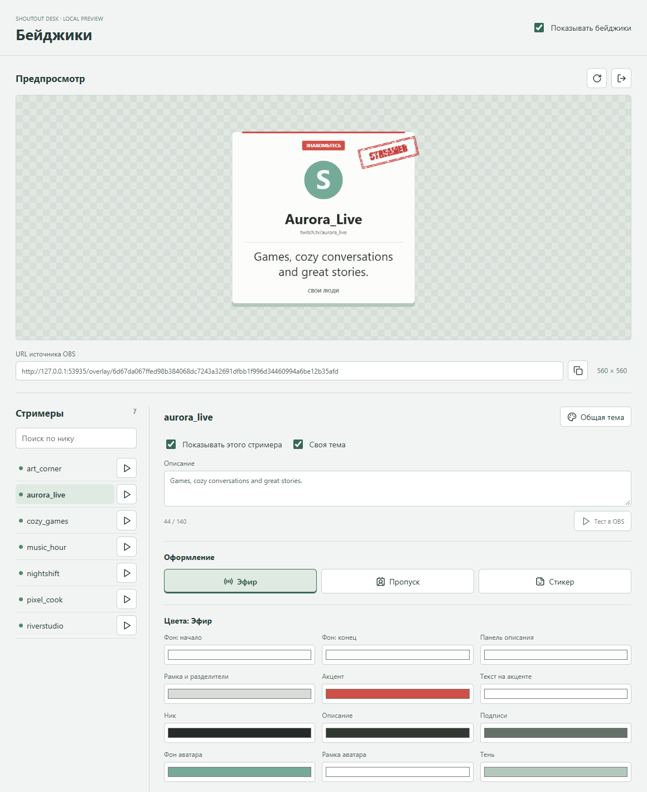

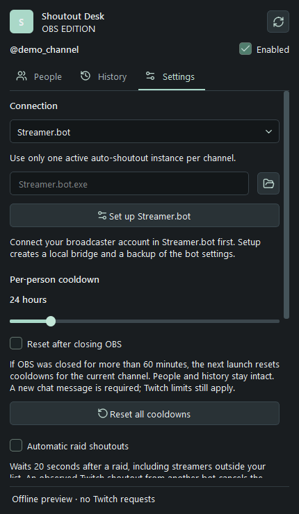

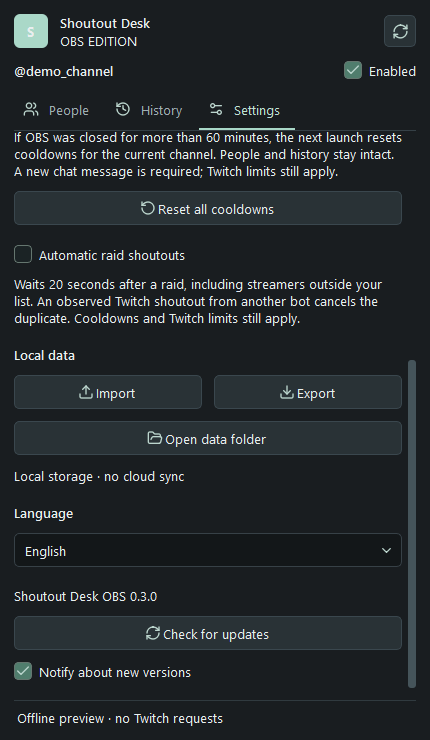

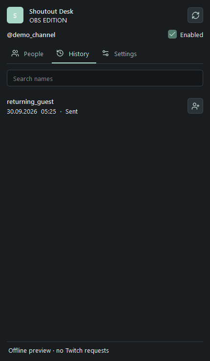

<a id="build"></a>
## Build from source

Windows x64, Node.js 24.14+, Visual Studio C++ Build Tools, Qt SDK (`QT_SDK` optional), Inno Setup 6.7.3 (`ISCC_EXE`).

```powershell
npm ci
npm run audit:source
npm test
npm run build
npm run package
$env:ISCC_EXE = 'C:\Tools\Inno Setup 6\ISCC.exe'
npm run installer
```

GPL-2.0-or-later. [License](LICENSE) · [Security](SECURITY.md) · [Third-party notices](THIRD_PARTY_NOTICES.md)

Technical references: [Twitch OAuth](https://dev.twitch.tv/docs/authentication/getting-tokens-oauth/#device-code-grant-flow), [Streamer.bot WebSocket](https://docs.streamer.bot/api/websocket), [OBS portable mode](https://obsproject.com/kb/portable-mode).
