# Shoutout Desk OBS

**0.6.0: Свои бейджики на HTML/CSS.** Седьмой вариант оформления: переменные и предпросмотр слева, HTML/CSS и готовое задание для ИИ справа. Общая тема или отдельная для стримера; шесть прежних дизайнов и данные сохраняются. После обновления полностью перезапусти OBS. [Формат шаблонов](docs/custom-badges.md).

**0.5.0: Приоритет рейдов, повторные отметки рейдеров с учётом лимитов Twitch и шесть настраиваемых бейджиков.**

[English](README.md) | [Українська](README.uk.md) | [Русский](README.ru.md)

Автоотметки Twitch в закрепляемой док-панели OBS Studio. Человек из списка получает шотаут после нового сообщения, если его таймаут закончился.

**[Скачать и установить](https://github.com/foolka/shoutout-desk-obs/releases/latest)**: Windows EXE + ZIP.

**Уже пользуетесь старой версией? [Перед обновлением: как сохранить или импортировать локальную базу](#legacy-import).**

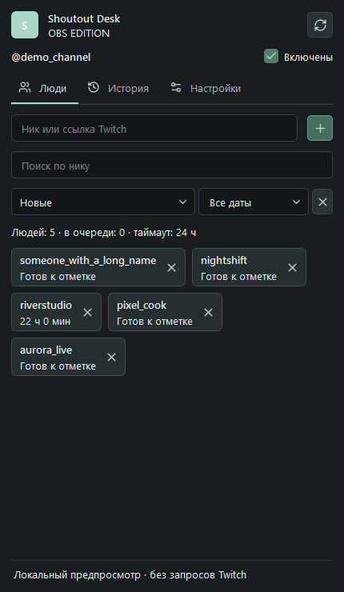

На скриншотах вымышленные аккаунты. Личных профилей в поставке нет.

## Оглавление

- [Очередь и восстановление обработчика](#recovery)
- [Импорт базы из самых первых версий](#legacy-import)
- [Скачать и установить](#install)
- [Настройка](#setup)
- [Настройки и кнопки](#settings)
- [Обновления и portable](#updates)
- [Отправка диагностических логов](#diagnostics)
- [Данные и приватность](#privacy)
- [Скриншоты](#screenshots)
- [Сборка из исходников](#build)

<a id="recovery"></a>
## Очередь и восстановление обработчика

Панель показывает следующего человека и минимальное время ожидания. Сообщения ждут минимум 10 секунд, рейды минимум 20 секунд, между отметками канала выдерживается минимум 125 секунд. Личные таймауты и ограничения Twitch могут увеличить ожидание. Причина пропуска или ошибки видна прямо в истории.

Краткий обрыв связи сохраняет очередь в рамках того же эфира. Новый эфир, смена аккаунта, пауза или ручное переподключение очищают ожидающие запросы; старый чат не воспроизводится. Временная ошибка до отправки запроса допускает повтор. Если запрос уже мог попасть в Twitch, результат остаётся неподтверждённым, чтобы не отправить дубликат.

Если локальный обработчик завершился или перестал отвечать, панель пробует перезапустить его до трёх раз, сохраняя паузу текущего сеанса. Если это не помогло, закройте OBS и установите полный свежий EXE поверх предыдущей версии; для portable OBS повторите установку полного ZIP. Не удаляйте папку данных и не отключайте антивирус. После исправления установки можно нажать переподключение в шапке панели. В **Настройки > Папка данных** находятся `worker-process.log` и, если создан, `worker-diagnostic.log`: в этих журналах нет токенов и паролей. Для диагностики присылайте только эти журналы, не базу и не файлы авторизации.

<a id="install"></a>
## Скачать и установить

Windows 10/11 x64, OBS Studio 32+ с Qt 6.8+. Скачайте **setup.exe** из Releases, закройте OBS и запустите установщик с подтверждением прав администратора. При необходимости укажите папку OBS. Откройте OBS привычным ярлыком, затем **Док-панели > Shoutout Desk**. Установщик не закрывает OBS и не запускает трансляцию.

<a id="legacy-import"></a>
## Импорт базы из самых первых версий

При обычном обновлении в том же профиле Windows база сохраняется автоматически: закройте программу и установите новую версию поверх старой. Импорт нужен при смене профиля/ПК или переходе между приложением и OBS-плагином.

1. В старой программе откройте **Настройки > Папка данных**. Если доступен **Экспорт**, сохраните JSON; иначе найдите **`shoutouts.sqlite`**. Обычно приложение хранит его в `%APPDATA%\Shoutout Desk`, а portable-копия в `ShoutoutDesk-data` рядом с EXE.
2. Нормально закройте старое приложение/OBS и сохраните копию **всей папки данных**. Копирование открытой SQLite-базы без WAL может потерять последние записи.
3. Откройте новую версию и подключите **тот же аккаунт стримера Twitch**.
4. Нажмите **Настройки > Импорт** и выберите JSON или **`shoutouts.sqlite`**, в том числе из самых первых версий. Не выбирайте `connection.json`, файлы авторизации или EXE.
5. Список, история и таймауты **объединяются**, а не заменяются; повторный импорт не дублирует ту же историю. Ожидавшие запросы не отправляются заново. После импорта автоотметки на паузе: проверьте результат и включите их.

Авторизация не импортируется. Сохраните бэкап до проверки результата. Новая база использует схему 3: для отката восстановите копию, сделанную до обновления, а не открывайте новую базу старой программой.

<a id="badges"></a>
## Бейджики шотаутов

Нажмите **Бейджики** в панели или значок рядом с человеком. Скопируйте URL источника из редактора, добавьте в OBS **Источник браузера** и установите размер **560 × 560**. Прозрачный локальный источник работает на порту `18772`, пока работает OBS-плагин. Полный URL источника сохраняется после перезапуска в том же профиле. Адрес редактора для источника не подходит.

- **Эфир / Пропуск / Стикер / Терминал / Билет / Портрет:** Шесть оформлений, каждое со своей палитрой. Старые темы и описания сохраняются. Настраиваются ширина, прозрачность фона и тени, размытие и смещение тени, стиль рамки, форма и обводка аватара, жирность текста, подписи, видимость адреса и сдвиг штампа по X/Y. Длинный ник уменьшается до одной строки, описание переносится.
- Общий и персональные переключатели, описания до 140 символов, общая или собственная тема. Можно изменить градиент, рамку, скругление, отступы, шрифты, цвета и размеры.
- По 10 эффектов появления и ухода с независимым выбором и настройкой времени показа. Печать настраивается отдельно: включение, текст, цвет, угол, положение и размеры. Она перекрывает угол, не сдвигая другие элементы.
- Кнопки **Тест в OBS** и тест рядом с человеком показывают только бейджик, без реального шотаута и изменения истории/таймаутов. Тест доступен даже при выключенном автоматическом показе. Автоматический показ требует свежего подтверждённого шотаута человека из списка; повторные подтверждения объединяются.

После изменений нажмите **Сохранить**. Редактор пока на русском. Пользователям Streamer.bot нужно повторить настройку связки для поддержки аватаров. При обновлении закройте OBS и установите новую версию поверх прежней, сохранив тот же профиль. Описания, оформление и адрес хранятся в профиле; JSON-экспорт людей их не переносит, поэтому для полного переноса сохраняйте всю папку данных. Не публикуйте адрес редактора. Не запускайте параллельно приложение и плагин для одного канала.

<a id="setup"></a>
## Настройка

1. В настройках выберите **Twitch напрямую / Самостоятельно** или **Streamer.bot**.
2. Напрямую: нажмите **Войти через Twitch**, подтвердите код на официальной странице Twitch и разрешите доступ к своему аккаунту стримера. Public Client ID уже включён, регистрировать приложение не нужно.
3. Streamer.bot: сначала подключите аккаунт стримера к Twitch в Streamer.bot 1.0.7. Нажмите **Настроить Streamer.bot**: запущенная копия определится автоматически, либо выберите EXE. Если появится просьба закрыть бота, выйдите через меню трея и повторите настройку. После настройки бот запустится снова. OBS закрывать не нужно.
4. Добавьте ники или ссылки на профили Twitch. Во время эфира новое сообщение человека из списка может поставить его в очередь на отметку.

На канал нужен **один активный экземпляр**: приложение или OBS-плагин. Между компьютерами базы таймаутов не синхронизируются. Если получено событие шотаута от другого бота, оно обновляет таймаут и отменяет дубль в очереди. Событие должно прийти подключённому экземпляру: прошлые шотауты до подключения автоматически не восстанавливаются.

<a id="settings"></a>
## Настройки и кнопки

| Настройка или кнопка | Действие |
| --- | --- |
| Отмечать входящие рейды | По умолчанию выключено. Ожидание минимум 20 секунд, учёт других ботов и таймаутов. Подробности ниже. |
| Сообщать о новых версиях | По умолчанию включено. Фоновая проверка GitHub и плашка релиза; без автоматической установки. |
| Включены | Пауза/возобновление автоотметок до закрытия. При каждом запуске снова включены; персональные таймауты от этого не сбрасываются. |
| Таймаут, 1–168 часов | Минимальный интервал для каждого человека в этом канале. По умолчанию 24 ч. После истечения нужно новое сообщение, автоматической массовой отправки нет. |
| Сбрасывать после долгого закрытия | По умолчанию выключено. Если программа была закрыта строго больше 60 минут, при запуске сбросятся персональные таймауты. История останется. При аварийном закрытии учитывается запас heartbeat 30 секунд. |
| Сбросить все таймауты | С подтверждением. Только текущий канал; список и история остаются, очередь очищается. Лимиты Twitch и общий интервал отправки продолжают действовать. |
| Способ подключения | Streamer.bot или Twitch напрямую. Данные канала сохраняются; у другого аккаунта свой список и история. |
| Войти / выйти | Авторизация своего аккаунта стримера. Выход удаляет сохранённый вход Twitch, но не список и историю. |
| Настроить Streamer.bot | Создаёт резервную копию actions/settings в backup бота, локальную связку с секретом и автозапуск WebSocket. Сохраняет порт, пароль и остальные действия. Неизвестные форматы и публичные сетевые адреса отклоняются. У приложения и OBS разные ID действий. |
| Переподключиться | Восстановить выбранное соединение. Старые сообщения не переигрываются, таймауты не сбрасываются. |
| Добавить / крестик | Ник или ссылка Twitch. Крестик убирает из активного списка, сохраняя историю и таймаут. Дубликаты объединяются. |
| Поиск / сортировка / дата | Фильтруют отображение по нику и дате добавления; сортировка от новых, старых или по нику. Не выключают людей из автоотметок. |
| История / Добавить | Результаты и ошибки. «Подтверждено Twitch» означает сохранённое событие Twitch, в том числе от другого инструмента; это не обязательно отправка нашим плагином. Старые сохранённые события тоже видны. Кнопка возвращает отсутствующего человека в список без отправки шотаута. |
| Импорт | Объединяет JSON-экспорт или старый shoutouts.sqlite того же канала. Сначала подключитесь. До импорта создаётся бэкап; автоотметки ставятся на паузу. Незавершённые запросы не отправляются заново. Перед копированием SQLite закройте исходную программу. |
| Экспорт | Новый JSON со списком, историей и таймаутами этого канала. Токены, пароли и секрет связки не экспортируются. |
| Папка данных | Текущий профиль и резервные копии. Не публикуйте содержимое. |
| Язык | Украинский, русский, английский. Отдельные диагностические сообщения могут оставаться на русском. |
| Проверить обновления | Ручная проверка стабильного релиза GitHub. Можно открыть новую версию в браузере. Без скрытой загрузки/установки; токены Twitch в GitHub не отправляются. |
| Закрепить / открепить | Кнопка в шапке меняет плавающее/закреплённое состояние. Панель можно перетащить к краю OBS; видимость и расположение управляются OBS. |

**Статусы:** Отправлен: подтверждено Twitch; В очереди/Отправляется: ожидание; Пропущен: отменён или больше не подходит; Ошибка: получен отказ; Нет подтверждения: исход неизвестен, повтор заблокирован на персональный таймаут. Перед отправкой есть окно 10 секунд для событий других ботов и общий интервал 125 секунд между отметками канала. Программа никогда не запускает стрим.

<a id="updates"></a>
### Автоотметки за рейды

**Отмечать входящие рейды** по умолчанию выключено. При включении рейдер получает приоритет перед ожидающими отметками из чата, даже если его нет в списке; автоматически в список он не добавляется. Ожидание 20 секунд даёт другому боту возможность уже отметить рейд. Наш персональный таймаут не блокирует новый рейд; ограничения Twitch сохраняются: одна отметка раз в 2 минуты и тот же канал раз в 60 минут, плюс запас 5 секунд. Ожидающий рейд резервирует очередь до разрешённого времени (не дольше двух часов), поэтому отметки из чата его не обгоняют. Уже отправленную до получения события рейда отметку отменить невозможно. Подтверждённая отметка после этого рейда отменяет его дубль; более ранняя только откладывает его.

Если за время ожидания получено событие настоящего Twitch-шотаута другого бота, дубль отменяется. Обычное сообщение в чате или текстовая команда `!so` без Twitch-шотаута таким событием не являются. Для защиты нужно рабочее соединение; абсолютной синхронизации независимых ботов нет.

### Уведомления об обновлениях

**Сообщать о новых версиях** по умолчанию включено. Первая фоновая проверка начинается примерно через 15 секунд после запуска; успешные проверки не чаще раза в сутки. Без интернета ошибки не мешают работе, проверка повторится позже. Новая стабильная версия показывается плашкой; приложение также может показать уведомление Windows. Автоматической загрузки и установки нет. Кнопка **Проверить обновления** работает и при выключенной фоновой проверке.

**Старые версии не могут получить эту функцию удалённо: один раз обновитесь вручную**, после этого появятся уведомления о следующих версиях. Запросы идут к публичному GitHub Releases API без токенов Twitch.

## Обновления и portable

Нажмите **Проверить обновления**, закройте OBS и запустите новый установщик. Обычный профиль остаётся в `%LOCALAPPDATA%\Shoutout Desk OBS`. Удаление плагина его не стирает.

**ZIP / ручная установка:** распакуйте целиком и запустите `Install.cmd` от администратора для обычного OBS. Проверяются хеши файлов, предыдущие файлы плагина сохраняются в резервной копии.

**Portable OBS:** из того же ZIP запустите `Install-Portable.cmd`, выберите `bin\64bit\obs64.exe` переносимого OBS. Сначала включите portable-режим OBS пустым `portable_mode.txt` в его корне. Плагин устанавливается в `obs-plugins\64bit` и `data\obs-plugins`; отдельный профиль хранится в `config\shoutout-desk-obs` внутри OBS. Для обновления повторите установку при закрытом OBS. Папку `config` сохраняйте; списки переносите Экспортом/Импортом. На другом ПК защищённый вход потребует повторной авторизации. Не устанавливайте одновременно общую и ручную копии для одного OBS.

<a id="diagnostics"></a>
## Отправка диагностических логов

Откройте **Настройки > Диагностика**, выберите **Последний час, 24 часа или 7 дней**, нажмите **Отправить логи** и подтвердите отправку. Передайте номер отчёта разработчику, чтобы он нашёл его.

Отчёт отправляется на `https://fermionaplay.win` и доступен только владельцу сайта **30 дней**. В нём указаны настроенный ник канала Twitch, версия, состояние подключения, счётчики и результаты очереди. Ники людей в событиях заменяются условными идентификаторами отдельно для каждого отчёта. Тексты чата, токены OAuth, пароли, исходные тексты ошибок и база людей не отправляются. Автоматической отправки нет. Обычные журналы доступа сервера могут содержать IP-адрес.

Подробные локальные журналы начинаются после этого обновления, ограничены по размеру и обновляются примерно за 7 дней; более ранние события берутся только из сохранённой истории. Лимит отчёта: 1800 событий / 512 КиБ, неполнота отмечается. При ошибке отправки данные не меняются, можно повторить позже. В OBS используется отдельный помощник диагностики: он может работать при недоступном основном обработчике, если встроенный runtime установлен полностью.

<a id="privacy"></a>
## Данные и приватность

### Вход и переподключение

При обрыве сети, лимитах запросов или временной ошибке Twitch плагин повторяет соединение без выхода из аккаунта. Сохранённый ник не означает, что соединение работает. Если Twitch действительно отклонил вход, OBS покажет неблокирующее предупреждение даже со скрытым доком: **«Открыть настройки»** покажет кнопку входа, **«Позже»** скроет уведомление до следующего запуска. Браузер сам не открывается. Список, история и таймауты сохраняются. При временных сбоях и в режиме Streamer.bot такое предупреждение не показывается.

Всё работает локально. Аккаунт на нашем сервере не создаётся. Вход Twitch через официальный Device Code flow: `user:read:chat` и `moderator:manage:shoutouts`; последнее является названием разрешения API, а не режимом модератора. Токены OAuth и секреты связки зашифрованы средствами Windows. JSON-экспорт содержит ники и время активности: делитесь им осознанно. Twitch получает подписки на чат и запросы отметок, GitHub вызывается при проверке обновлений. Бэкапы остаются локально.

EXE и ZIP находятся в **GitHub Releases**, исходники хранятся отдельно без бинарников. Сборки не подписаны сертификатом: Windows может показывать предупреждение репутации. Проверяйте репозиторий и SHA256, не отключайте системную защиту.

<a id="screenshots"></a>
## Скриншоты

Шесть оформлений бейджиков с отдельными палитрами. Ниже реальные снимки с вымышленным аккаунтом. Старые оформления и персональные настройки остаются доступными.

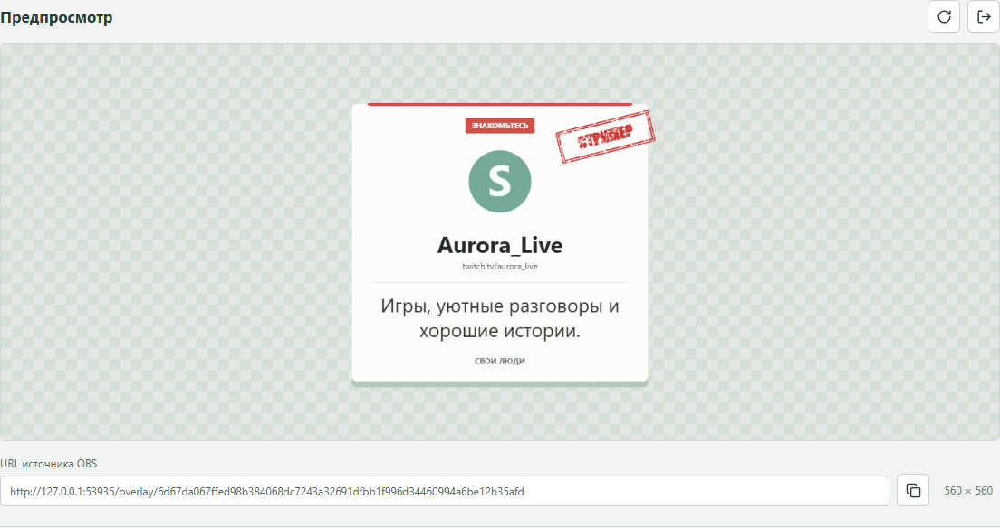

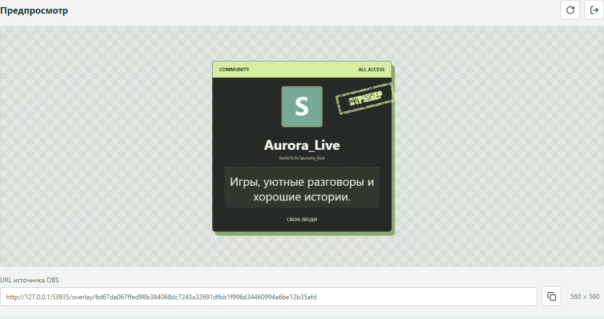

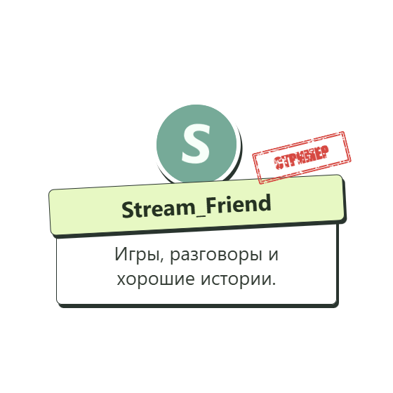

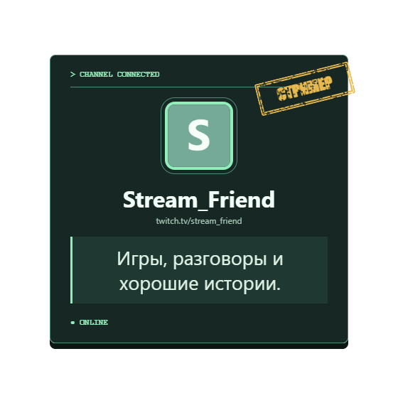

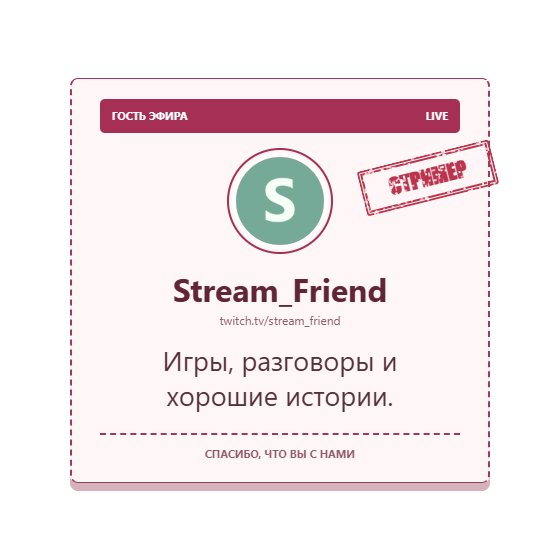

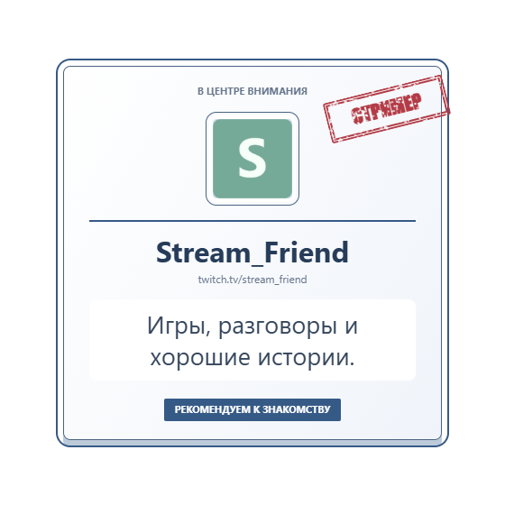

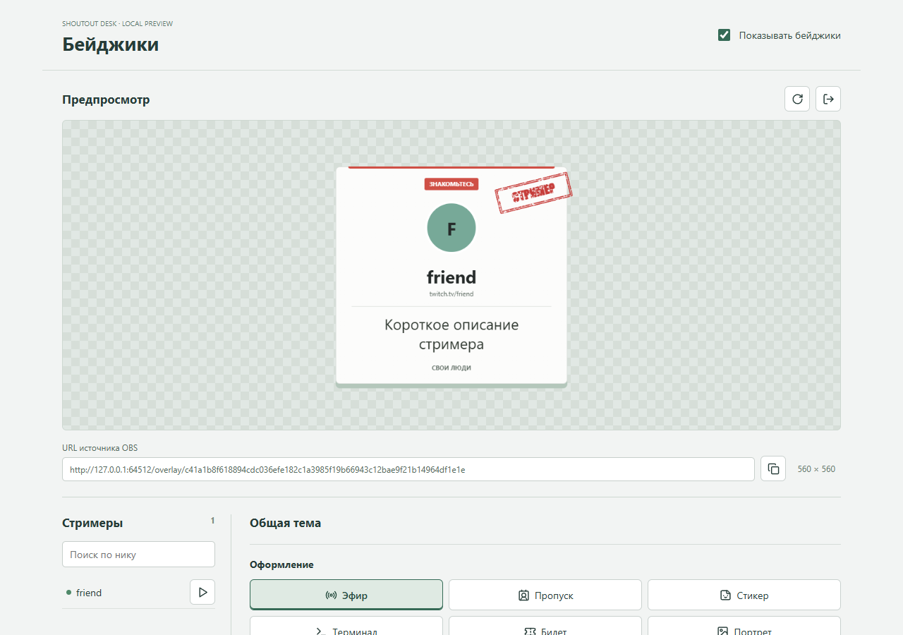

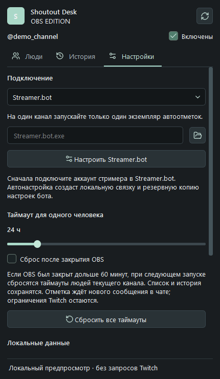

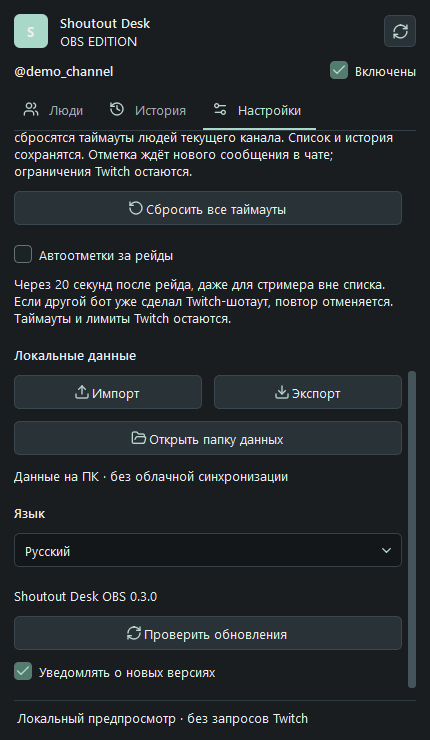

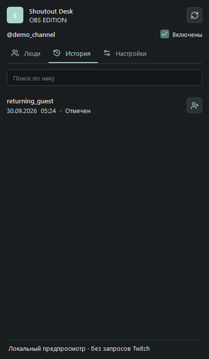

<a id="build"></a>
## Сборка из исходников

Windows x64, Node.js 24.14+, Visual Studio C++ Build Tools, Qt SDK (`QT_SDK` optional), Inno Setup 6.7.3 (`ISCC_EXE`).

```powershell
npm ci
npm run audit:source
npm test
npm run build
npm run package
$env:ISCC_EXE = 'C:\Tools\Inno Setup 6\ISCC.exe'
npm run installer
```

GPL-2.0-or-later. [License](LICENSE) · [Security](SECURITY.md) · [Third-party notices](THIRD_PARTY_NOTICES.md)

Technical references: [Twitch OAuth](https://dev.twitch.tv/docs/authentication/getting-tokens-oauth/#device-code-grant-flow), [Streamer.bot WebSocket](https://docs.streamer.bot/api/websocket), [OBS portable mode](https://obsproject.com/kb/portable-mode).
